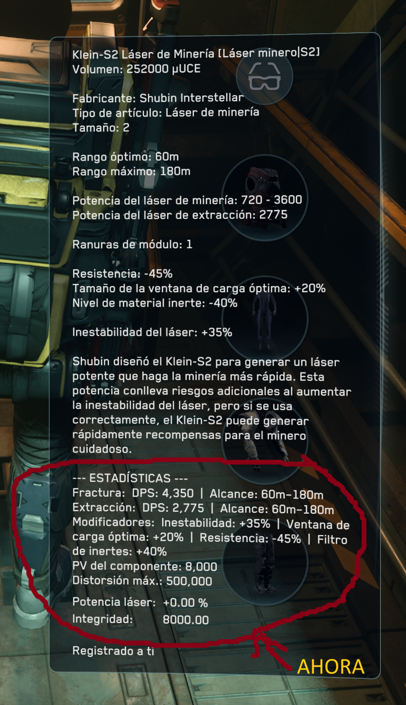
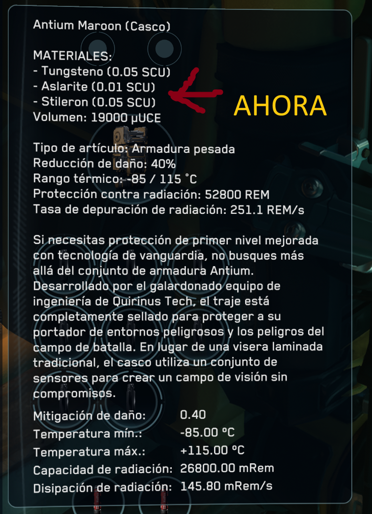
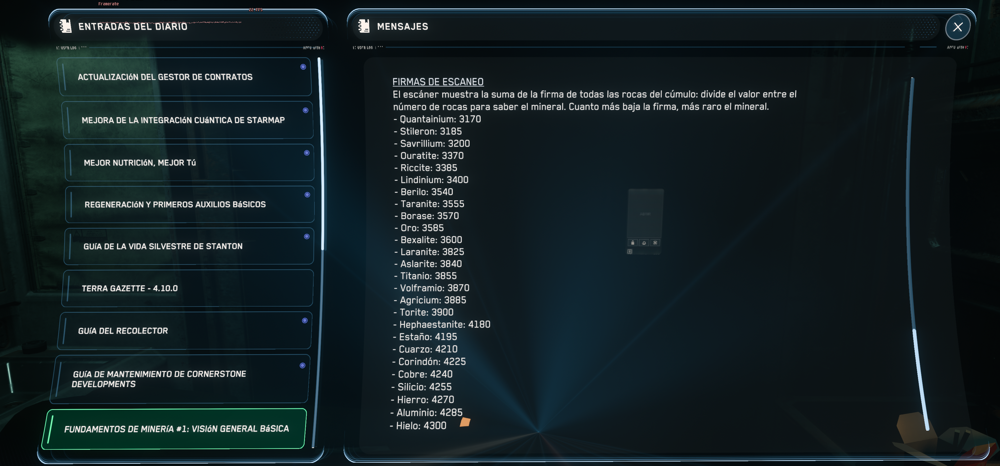
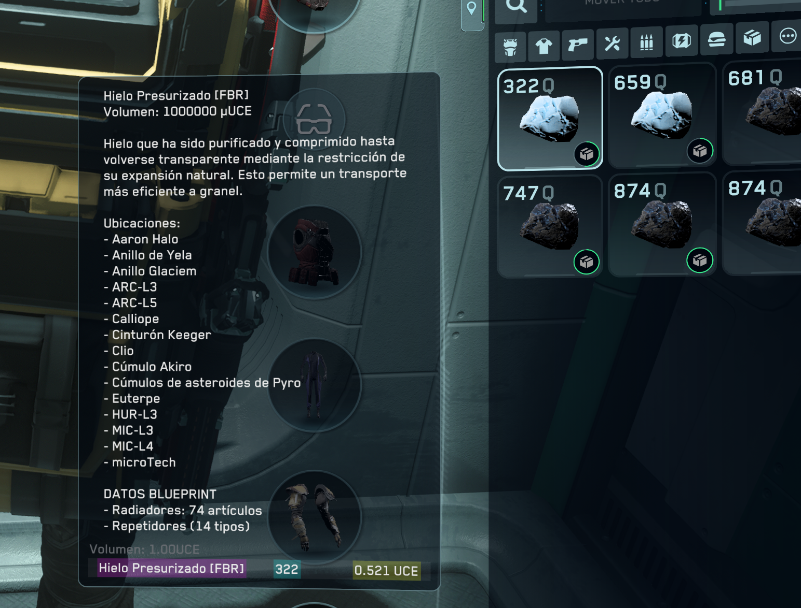
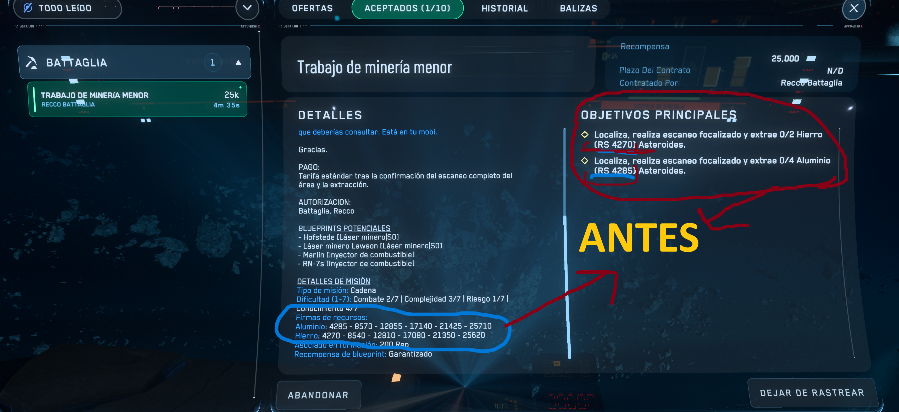
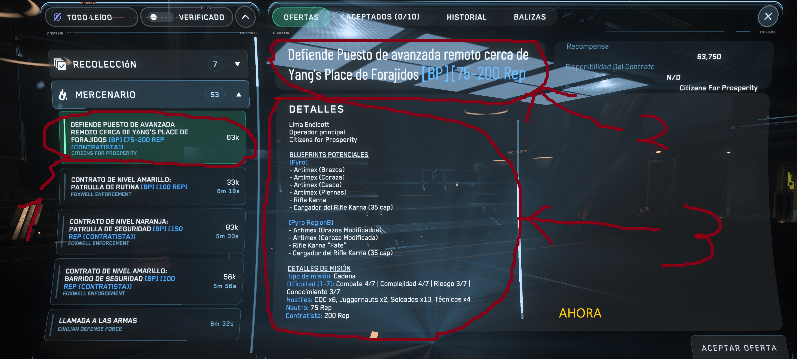
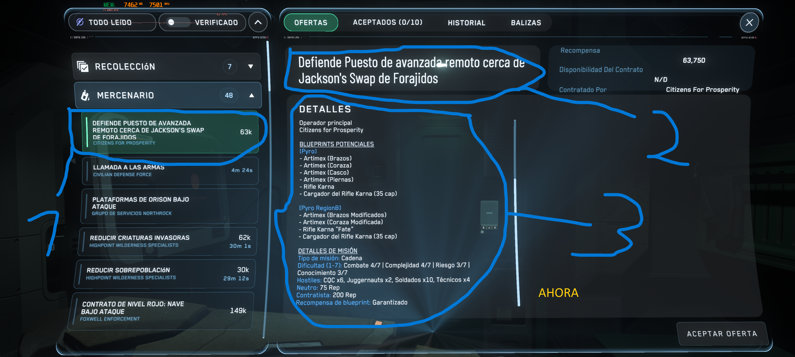

# Star_citizen_traducion.ES
Traducción al español de Star Citizen, traducción, español, Spanish, Latinoamérica, España, StarCitizenTranslation
# compatible con el LIVE  y PTU
Proyecto de traducción al español de Star Citizen. 

SI VAS A CREAR UNA CUENTA NUEVA SE AGRADECE SI USAS MI CÓDIGO (STAR-6W9K-GDJB)
 
https://www.robertsspaceindustries.com/enlist?referral=STAR-6W9K-GDJB

ÚNETE AL DISCORD DE CCBE

https://discord.gg/8ZpvNM5qRB

WEB DE LA COMPAÑÍA CCBE

https://ccbe.space/

# :Descarga:
:point_right:  [Ultima versión ](https://github.com/juniormaos-max/Star_citizen_traducion.ES/releases) :point_left:

#Dame tu apoyo en RSI

# Instalación
Descomprime el contenido del Zip en la raiz de instalación de SC ejemplo: `C:\Program Files\Roberts Space Industries\StarCitizen\`

# Muestra 

La parte de **ESTADÍSTICAS** (peso, cadencia, daño, DPS, munición, velocidad, alcance, consumo...) son datos del propio juego: la traducción solo les puso las etiquetas en español para que salgan visibles. Solo disponible en la edición MAX.

La parte de **MATERIALES** (lo necesario para fabricar cada objeto) también son datos del juego. Ya vuelve a estar activada.

La tabla de **FIRMAS DE ESCANEO** está en el diario de minería del mobiGlas: relaciona cada mineral con su firma para identificarlo al escanear.

Las fichas de materiales traen sus **UBICACIONES** (dónde encontrarlos) y los **DATOS BLUEPRINT** (en qué se usan para fabricar), sacados de los datos del juego.

En las misiones de minaria **DETALLES DE MISION** ahora sale las firmas de los materiales.

# Contratos: antes y ahora

En los contratos, la rep aparece en los detalles de cada misión, no en la parte de títulos.

