# 🚀 Star Citizen — Traducción al Español (ES / Latam)

[](https://github.com/juniormaos-max/Star_citizen_traducion.ES/releases)
[](https://robertsspaceindustries.com)
[](https://github.com/juniormaos-max/Star_citizen_traducion.ES/releases)
[](https://github.com/juniormaos-max/Star_citizen_traducion.ES/releases)

---

## 🎮 Sobre este proyecto

Traducción comunitaria del archivo de localización `global.ini` de **Star Citizen** al español, con dos variantes regionales:

- **ES** — español de España (uso de *vosotros*, vocabulario de España)
- **Latam** — español de Latinoamérica (uso de *ustedes*, vocabulario neutro latinoamericano)
- **EN** - una version en ingles con todo lo que esta en la version españa.

El proyecto se construye sobre un pipeline propio de varias etapas de revisión y genera paquetes ZIP listos para instalar directamente en el juego.

> **Compatibilidad:** LIVE de Star Citizen.

---

## 🔀 ¿Qué versión elegir?

| Variante | Región | Pronombre | Ideal para |
|----------|--------|-----------|------------|
| **ES** | España | Vosotros | Jugadores de España que prefieren vocabulario local |
| **Latam** | Latinoamérica | Ustedes | Jugadores de América que prefieren español neutro |

---
## 📥 Instalación paso a paso

1. **Descarga** la última versión desde los [releases](https://github.com/juniormaos-max/Star_citizen_traducion.ES/releases).
2. **Descomprime** el contenido del ZIP en la raíz de instalación de Star Citizen, por ejemplo:

   ```
   C:\Program Files\Roberts Space Industries\StarCitizen\
   ```

3. **Inicia el juego** y verifica que los textos aparezcan en español.

---

## ✅ ¿Qué está traducido?

| Sistema | Estado | Notas |
|---------|--------|-------|
| Interfaz de usuario (UI) | ✅ Traducido | Incluye menús, HUD y pantallas |
| Misiones y contratos | ✅ Traducido | Títulos, detalles y reputación |
| Minería y commodities | ✅ Traducido | Firmas de escaneo, ubicaciones, materiales |
| Crafting y fabricación | ✅ Traducido | Recetas, componentes, materiales |
| Ítems y equipamiento | ✅ Traducido | Armas, armaduras, escudos, motores |
| Pinturas de naves (Paint_*) | ⚠️ Parcial | Algunas claves adicionales pueden no estar traducidas |

---

## 🤝 Soporte y comunidad

Si vas a crear una cuenta nueva en Star Citizen, se agradece si usas mi código de referencia:

**STAR-6W9K-GDJB**

👉 https://www.robertsspaceindustries.com/enlist?referral=STAR-6W9K-GDJB

Únete al Discord de la comunidad CCBE:

👉 https://discord.gg/8ZpvNM5qRB

Web de la compañía CCBE:

👉 https://ccbe.space/

---

## 🐛 Reportar errores o sugerencias

Si encuentras textos sin traducir, errores de ortografía o problemas con la instalación, abre un issue en el repositorio:

👉 [Nuevo issue en GitHub](https://github.com/juniormaos-max/Star_citizen_traducion.ES/issues)

👉 Tambien puedes encontrarme en el discord de la CCBE https://discord.gg/8ZpvNM5qRB  para informar de errores de ortografía o problemas con la instalación.

Incluye:
- Versión del juego (LIVE)
- Variante instalada (ES o Latam)
- Captura de pantalla del error (si aplica)
- Texto original y texto esperado

---

## 🏆 Créditos

- **Pipeline de traducción:** desarrollo propio con etapas de revisión (`rev1 → rev2 → rev3`)
- **Datos técnicos:** extraídos de los archivos DataForge de Star Citizen (crafting, minería, commodities)
- **Imágenes y capturas:** aportes de la comunidad
- **Soporte:** comunidad CCBE y Discord


---

## 🖼️ Galería: antes y después

A continuación se muestran ejemplos reales de la traducción en el juego.

### Interfaz y estadísticas


Las estadísticas de armas y equipamiento (peso, cadencia, daño, DPS, munición, velocidad, alcance, consumo) aparecen con sus etiquetas en español.

### Materiales y fabricación


Los materiales necesarios para fabricar cada objeto se muestran traducidos.

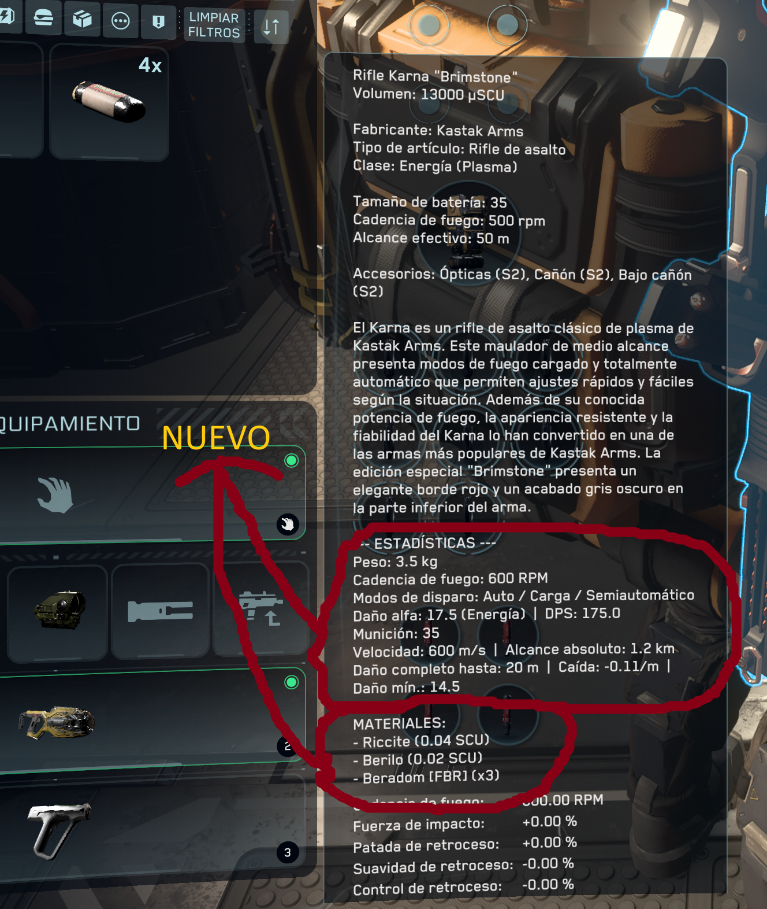

Detalles del arma y sus materiales, traducidos al español.

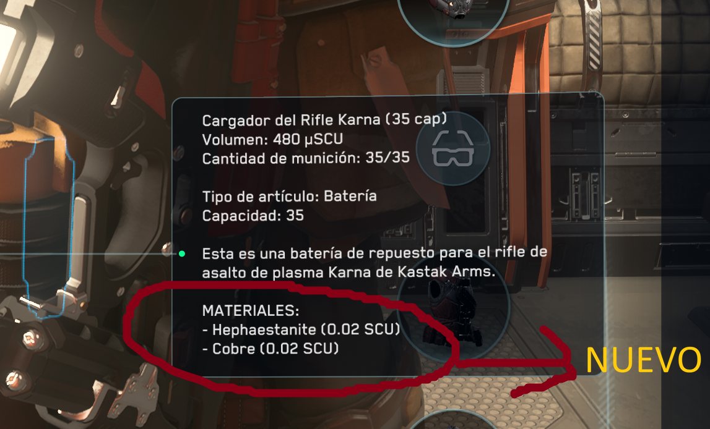

Ejemplo de componente con descripción en español.

### Minería y firmas de escaneo


Tabla de firmas de escaneo en el diario de minería del mobiGlas: relaciona cada mineral con su firma para identificarlo al escanear.

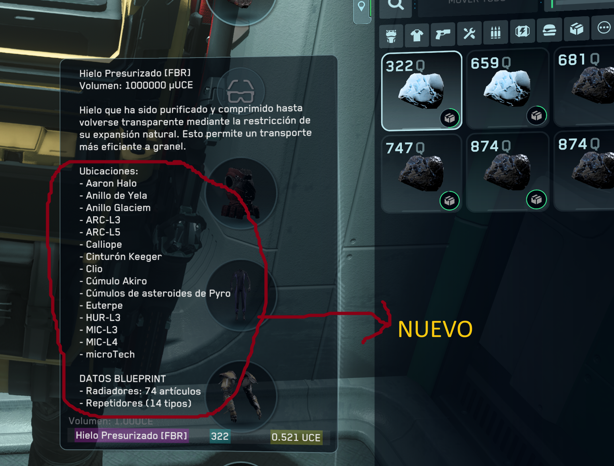

Las fichas de materiales incluyen sus ubicaciones (dónde encontrarlos) y los datos blueprint (en qué se usan para fabricar).


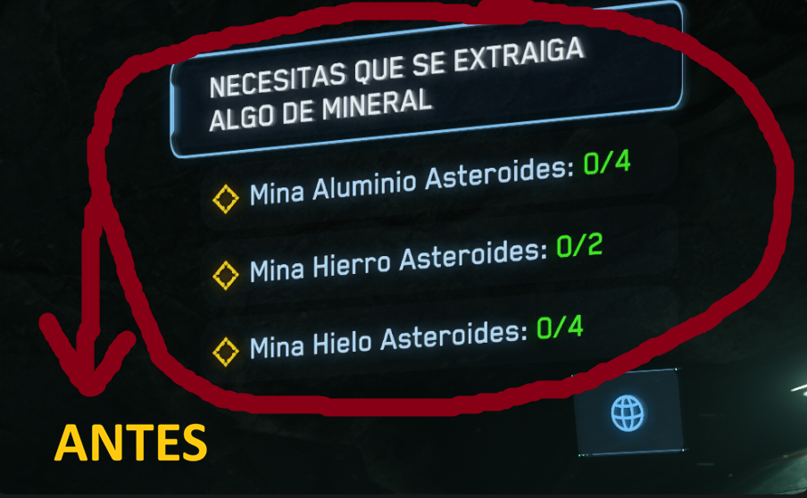
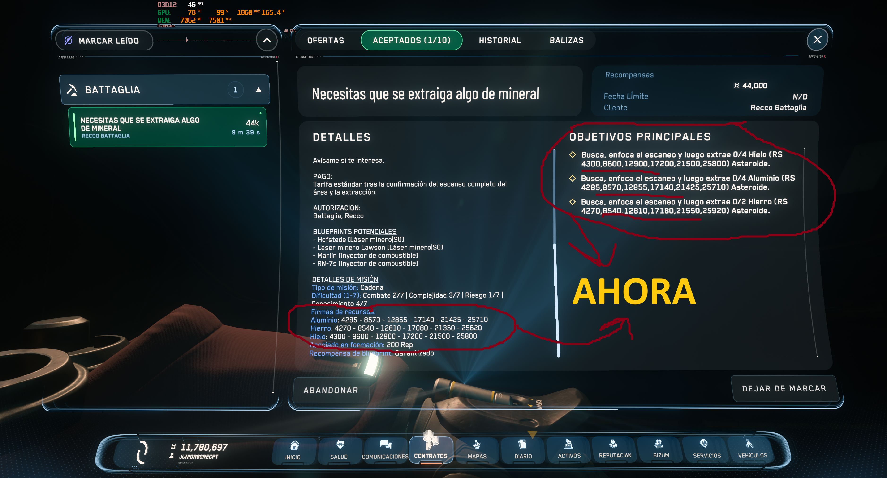
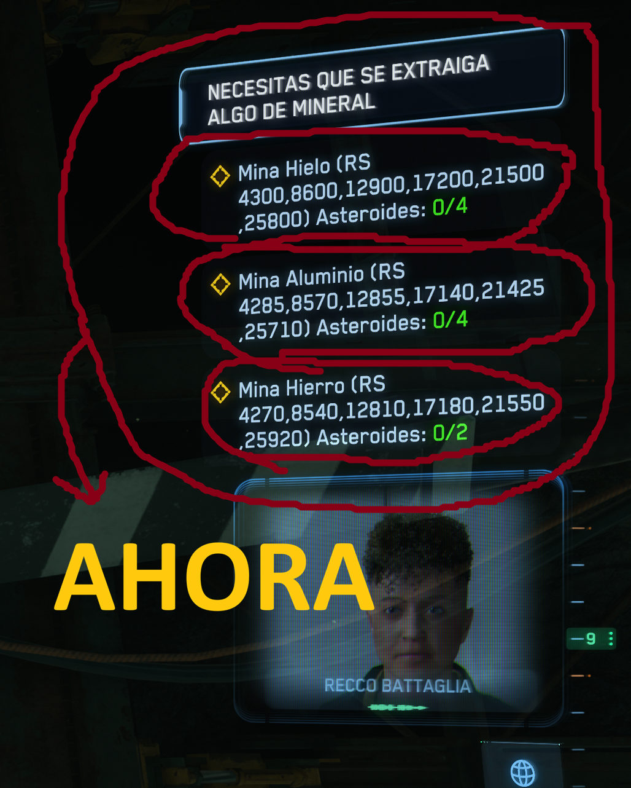

En las misiones de minería o en las misiones de battaglia, los detalles de misión muestran las firmas de los materiales minables.
En la primera foto de ANTES en el global.ini del juego no sale las firmas de los materiales minables esto lo busque yo y lo añadi ya que el proprio juego los tiene pero no la orden para aparecer en la pantalla.

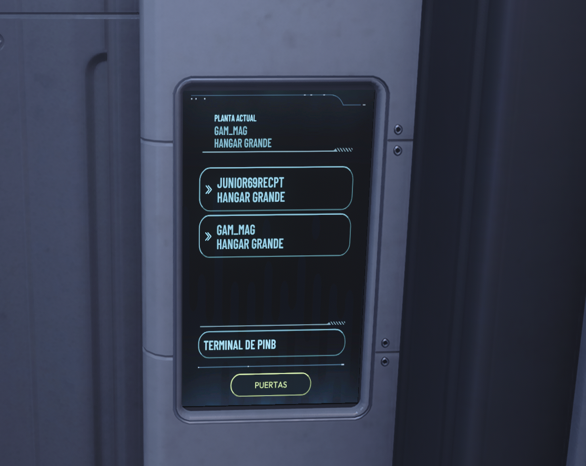

### Antes y después: ascensor de Levski (Nyx)

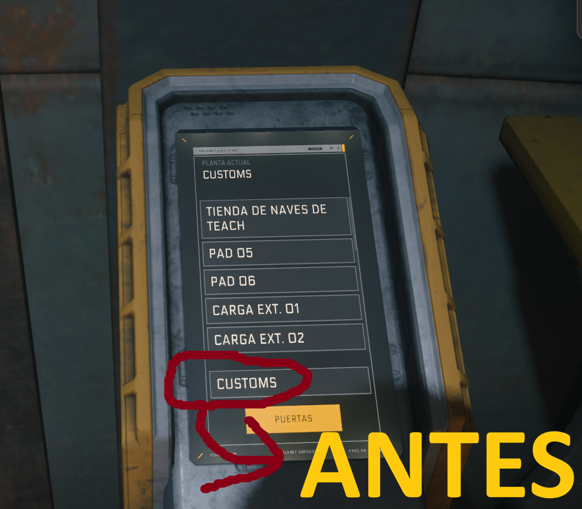

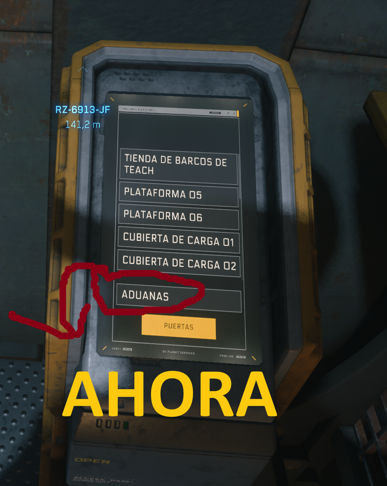

Pantalla del ascensor en Nyx (Levski): antes ponía **CUSTOMS** y ahora **ADUANAS**.

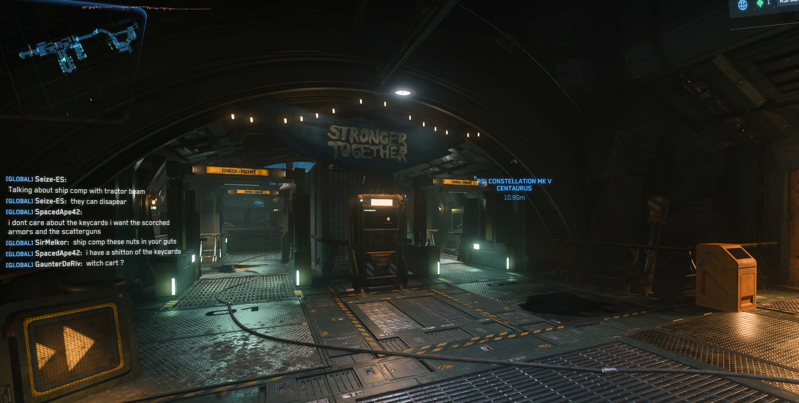

Al salir del ascensor en Levski está la aduana en el juego; en el `global.ini` se dejó tal cual: **ADUANAS**.

### Criaturas de New Babbage

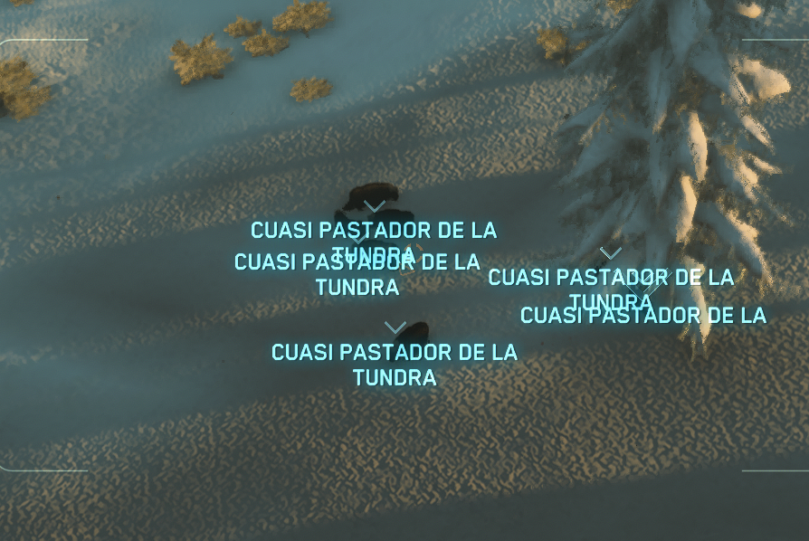

Criaturas en New Babbage: **CUASI PASTADOR DE LA TUNDRA**.

### Contratos: antes y después


En los contratos, la reputación (rep) aparece en los detalles de cada misión, no solo en los títulos.

---

*Última actualización: versión compatible con Star Citizen 4.10.2*

